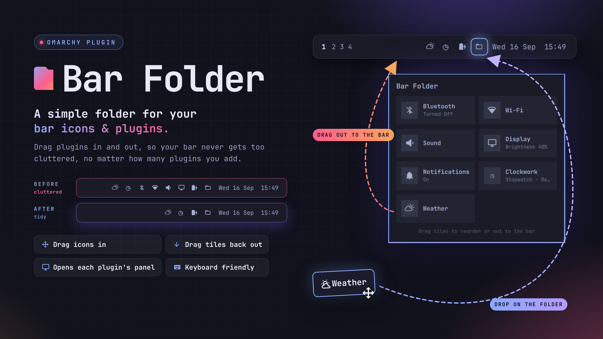
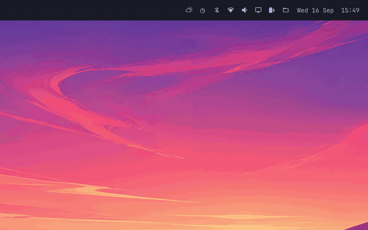
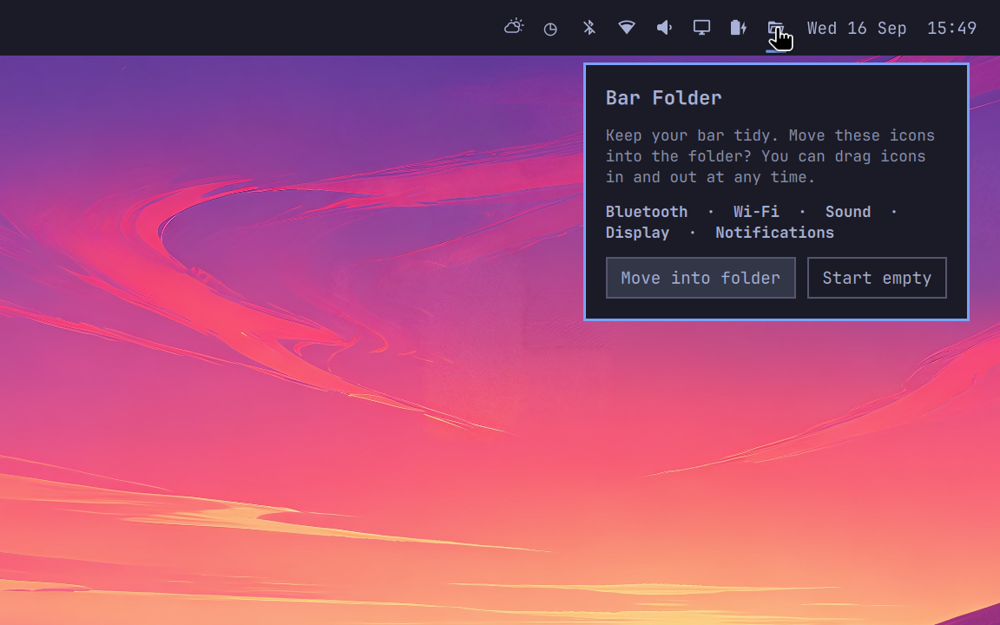
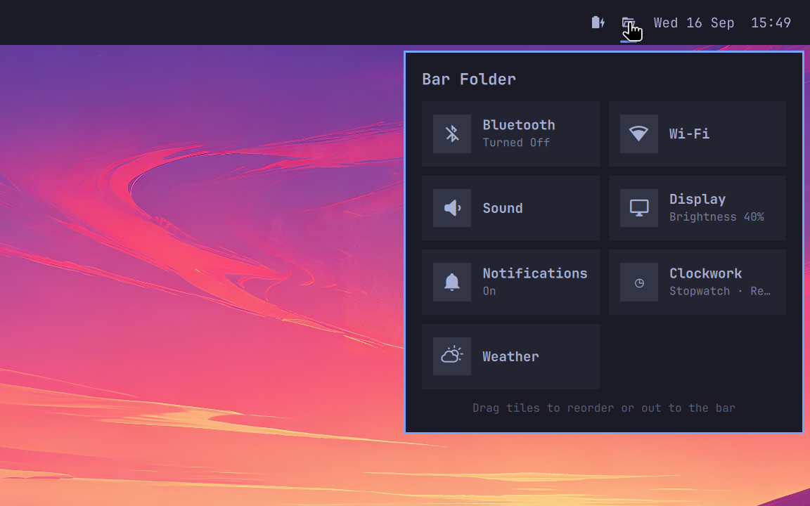
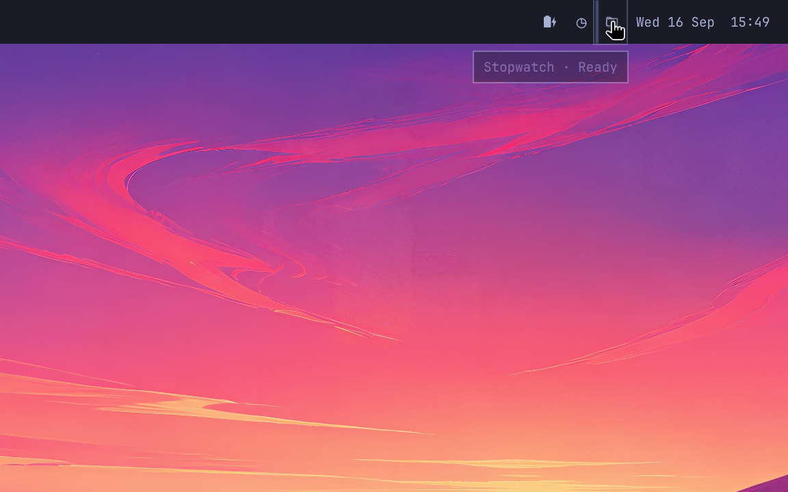
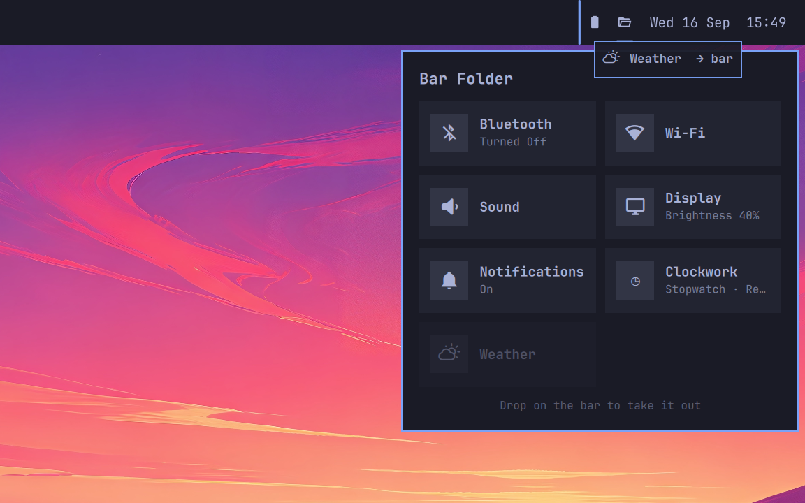
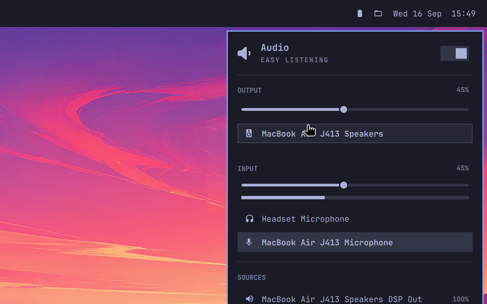

# Bar Folder



**A simple menu bar folder for your Omarchy bar icons and plugins.**

Every plugin you install wants its own icon in the bar, and sooner or later the bar gets too cluttered. Bar Folder puts one folder icon on the bar and keeps the others inside it. Drag an icon onto the folder to tuck it away, and drag it back out whenever you want it on the bar again.



[Watch the demo in full quality (MP4)](docs/demo.mp4)

## Features

- **Drag icons in.** Drag any icon from the bar and drop it on the folder icon.
- **Drag tiles back out.** Drag a tile out of the folder and drop it on the bar, right where the insertion marker shows. Drop it anywhere else outside the folder and it goes back next to the folder icon.
- **Reorder** tiles by dropping one tile on another.
- **Every plugin keeps working.** A left-click on a tile opens that plugin's own panel. Right-click, middle-click and scrolling are forwarded to the plugin, so scrolling over Sound still changes the volume.
- **Keyboard friendly.** Arrow keys or `h` `j` `k` `l` move between tiles, `Enter` opens one, `Esc` closes the folder.
- **Built-in Notifications tile.** Click to toggle Do Not Disturb, right-click to show recent notifications again.
- **Plugins with a background service keep working.** Plugins such as a blue-light filter that come with their own service are started by Bar Folder while they live in the folder, and handed back to the shell when you drag them out.
- **Settings travel along.** Inline settings of a widget, such as `showPercentage` on Power, are kept while it lives in the folder and restored when you drag it out.
- **Follows your Omarchy theme.**

| First run | The folder |
| --- | --- |
|  |  |

| Drag an icon into the folder | Drag a tile back out to the bar |
| --- | --- |
|  |  |

| Opening a plugin from the folder |
| --- |
|  |

## Requirements

- Omarchy with the Quickshell-based shell (Omarchy Quattro)
- `jq`, which Omarchy ships by default

No sudo, no network access and no extra packages.

## Install

```sh
omarchy plugin add https://github.com/arikisonfire/omarchy-bar-folder.git --enable
```

The folder icon appears in the right section of the bar.

### First run

Nothing on your bar changes on its own. The first time you open the folder, it asks whether it should move the default icons in:

**Bluetooth · Wi-Fi · Sound · Display · Notifications**

- **Move into folder** moves those icons from the bar into the folder.
- **Start empty** leaves the bar as it is. Drag icons in whenever you like.

## Usage

| Action | Result |
| --- | --- |
| Click the folder icon | Open or close the folder |
| Drag a bar icon onto the folder icon | Move it into the folder |
| Drag a tile onto the bar | Move it back to the bar at that position |
| Drag a tile anywhere outside the folder | Move it back to the bar, next to the folder icon |
| Drag a tile onto another tile | Reorder |
| Left-click a tile | Open that plugin's panel |
| Right- or middle-click, scroll on a tile | Forwarded to the plugin |

## Configuration

Bar Folder stores everything in its own entry in `~/.config/omarchy/shell.json`. Drag and drop keeps this entry up to date, but you can also edit it by hand:

```json
{
  "id": "io.github.arikisonfire.bar-folder",
  "widgets": ["omarchy.bluetooth", "omarchy.network", "omarchy.audio", "omarchy.monitor", "builtin.notifications"],
  "labels": { "omarchy.network": "Wi-Fi" },
  "icons": { "some.plugin": "󰔛" },
  "columns": 2,
  "icon": "󰉖",
  "iconOpen": "󰷏"
}
```

| Key | Meaning |
| --- | --- |
| `widgets` | Widget ids inside the folder, in tile order |
| `labels` | Optional tile titles per widget id |
| `icons` | Optional fallback glyph for widgets that draw no icon glyph |
| `columns` | Number of tile columns, 1 to 4 (default 2) |
| `icon`, `iconOpen` | Glyphs for the folder icon when closed and open |
| `widgetSettings` | Inline settings of widgets inside the folder (managed automatically) |

## Keybindings (optional)

Widgets inside the folder are no longer on the bar, so `omarchy-shell shell toggle <id>` cannot find them. Toggle them through Bar Folder instead:

```sh
omarchy-shell io.github.arikisonfire.bar-folder toggle                        # open or close the folder
omarchy-shell io.github.arikisonfire.bar-folder toggleWidget omarchy.monitor  # a widget's own panel
```

For example, in `~/.config/hypr/bindings.lua`:

```lua
hl.unbind("SUPER + CTRL + D")
o.bind("SUPER + CTRL + D", "Display", "omarchy-shell io.github.arikisonfire.bar-folder toggleWidget omarchy.monitor")
```

## Update

```sh
omarchy plugin update io.github.arikisonfire.bar-folder
```

## Uninstall

Put every icon back on the bar first, otherwise they disappear together with the folder:

```sh
~/.config/omarchy/plugins/io.github.arikisonfire.bar-folder/layout.sh release-all
omarchy plugin remove io.github.arikisonfire.bar-folder
```

If you already removed the plugin, add the icons back with `omarchy bar put <id>`.

## How it works

- Widgets inside the folder are loaded from their own entry points, invisible and zero-width underneath the folder icon. Their panels open right below the folder, just as they would from the bar.
- The Omarchy bar has no drag-and-drop API for plugins. Bar Folder watches the bar's own drag state to notice when an icon is released over the folder. A future Omarchy update may change these internals. If dragging into the folder stops working, please open an issue.
- Moving widgets rewrites `bar.layout` in `shell.json` atomically with Omarchy's own `omarchy-shell-config` helper. It only runs after you drag something or confirm the first-run prompt.
- `omarchy plugin list` shows third-party plugins that live in the folder as disabled, because they are no longer in the bar layout. They keep working.
- The shell only runs a plugin's service while that plugin is on the bar. For plugins inside the folder, Bar Folder's own service starts it instead, exactly once no matter how many bars you have, and hands it only to that plugin's widget. As soon as the plugin is back on the bar, the shell takes over again. Lock and polkit clones and `keepLoaded` services are never started by Bar Folder.
- Plugins inside the folder share the folder's part of the shell, much like widgets on the bar share the bar. Only put plugins in the folder that you would also trust on your bar.
- Tile subtitles show the first line of a plugin's tooltip, so long or multi-line tooltips never overflow a tile.
- Widgets are resolved the same way the shell resolves plugins: manifests are validated, entry points must stay inside their plugin directory, third-party plugins cannot take over `omarchy.*` or other first-party ids, and a local clone only replaces a built-in when that clone is enabled. Tile titles are rendered as plain text.

## License

[MIT](LICENSE)
